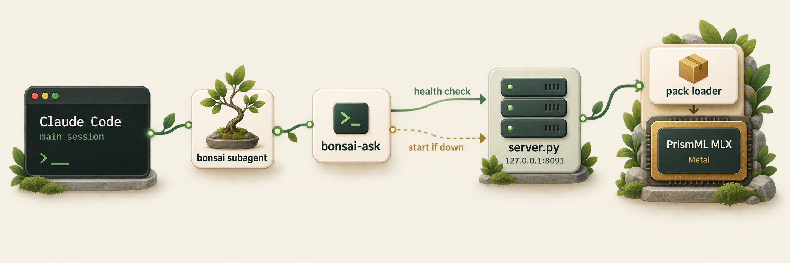

# swift-agent

Claude Code subagents that run tasks on local models on Apple Silicon. The `swift` agent runs [Swift 1.5](https://huggingface.co/ukisai/Swift-1.5-Qwen3.8-27B-GGUF), a Qwen3.8-27B fine-tune served by [splash](https://github.com/incoai/splash). The `bonsai` agent runs [Bonsai 2 27B](https://huggingface.co/prism-ml/Ternary-Bonsai-2-27B-mlx-2bit) through MLX. Each server starts itself on the first request.

Both agents use the same relay pattern. See [Swift 1.5 through splash](#swift-15-through-splash) for the Swift side. The other sections describe the Bonsai side.

PrismML ships no MLX server for Bonsai 2. `mlx_lm.server` and `mlx_vlm.server` load the pack without its Hadamard transform and return wrong output with no error. `server.py` loads the model through the loader bundled in the pack instead.

## Quick start

Requires Apple Silicon, [`uv`](https://docs.astral.sh/uv/), and [splash](https://github.com/incoai/splash) for Swift 1.5. Bonsai 2 takes about 12 GB of disk and Swift 1.5 about 17.4 GB.

```bash
git clone https://github.com/michael-denyer/swift-agent.git
```

```bash
./swift-agent/install.sh
```

```bash
swift-ask --no-think "What is 17 * 23? Reply with the number only."
```

```bash
bonsai-ask --no-think "What is 17 * 23? Reply with the number only."
```

In Claude Code, ask for the `swift` or `bonsai` agent by name, or say "use the local model".

## How it works



`bonsai-ask` decides what to do from two facts, the health endpoint and the pidfile.

| Health | Pidfile process | Action |
|---|---|---|
| ok | any | Use the running server. |
| down | alive | Wait. Another caller is starting it. |
| down | dead or missing | Remove the stale pidfile, start the server, wait. |

An exclusive lock on the start path means concurrent callers produce one server. If the server dies while starting, `bonsai-ask` exits nonzero and prints the tail of the server log.

## Usage

```
bonsai-ask [--no-think] [--effort {xhigh,medium,low}] [--max-tokens N] [--system TEXT] [PROMPT]
bonsai-ask --status
bonsai-ask --stop
```

The prompt comes from stdin when no positional argument is given. Only the answer goes to stdout. The model's thinking is dropped from the output.

| Variable | Default | Purpose |
|---|---|---|
| `BONSAI_HOME` | `~/.local/share/bonsai` | Venv, model, MLX source, logs, pidfile. |
| `BONSAI_PORT` | `8091` | Server port on `127.0.0.1`. |

The server also answers `POST /v1/chat/completions` in the OpenAI shape, without streaming, and `GET /health`.

## Swift 1.5 through splash

`swift-ask` and `agents/swift.md` are the Swift 1.5 counterparts of `bonsai-ask` and `agents/bonsai.md`. The server is splash, not `server.py`, so the only extra requirement is `brew install incoai/tap/splash`. `install.sh` links both entry points and warns when splash is missing.

```bash
swift-ask --no-think "What is 17 * 23? Reply with the number only."
```

In Claude Code, ask for the `swift` agent by name. Its description tells the main session to prefer it over `bonsai`.

```
swift-ask [--no-think] [--effort {max,xhigh,high,medium,low,minimal}] [--max-tokens N] [--system TEXT] [PROMPT]
swift-ask --status
swift-ask --stop
```

| Variable | Default | Purpose |
|---|---|---|
| `SWIFT_HOME` | `~/.local/share/swift` | Logs, pidfile, start lock. |
| `SWIFT_MODEL` | `ukisai/Swift-1.5-Qwen3.8-27B-GGUF:Q4_K_M` | The model splash serves, as `splash serve --model` takes it. |
| `SWIFT_PORT` | `8000` | Server port on `127.0.0.1`, splash's default. |

`swift-ask` decides what to do from `GET /ready` and its pidfile, with the same table as `bonsai-ask`. It starts `splash serve --model $SWIFT_MODEL --language-only --no-webui` detached, and its pidfile identity check requires a `splash serve` command line that names the model. The first start downloads the 17.4 GB GGUF from the Hugging Face Hub into the Hub cache and can take as long as the connection allows, so the ready wait is 30 minutes. Later starts load from the cache in about 8 seconds, plus about 30 seconds when splash calibrates its Neural Engine split, and a cold `swift-ask` call with cached weights answered in 23 seconds on an M5 Pro on 2026-10-13. The same machine decoded a 98-token answer at 58 tokens per second and 4-token answers at about 16. splash releases the weights after 10 idle minutes and reloads them on the next request.

The model is ukisai's GGUF release because splash 1.3.1 stopped loading Splash packages ([incoai/splash#335](https://github.com/incoai/splash/pull/335)), so the older `SiliconSpecies/Swift-1.5-Qwen3.8-27B-Splash` package does not load on 1.3.1 or later. The MLX release `ukisai/Swift-1.5-4bit-MLX` loads on splash 1.3.1 but returns mixed-script garbage for every prompt, with or without `--disable-ane`, measured on 2026-10-13 on an M5 Pro. That checkpoint quantizes its embedding table and output head, and splash's mixed-precision MLX loading is four days old, so the GGUF path is the one this repository uses. The weights are under the swift-open-license-1.0 that the model repository carries.

## The MLX runtime

`install.sh` installs the stock `mlx==0.32.2` wheel. The Bonsai 2 pack uses only stock MLX operations, so it needs nothing from the [PrismML MLX fork](https://github.com/PrismML-Eng/mlx).

Measured on an M5 Pro in High Power mode on 2026-09-18, median of 3 runs, with `tools/bench.py`:

| Metric | Fork build | `mlx==0.32.2` |
|---|---|---|
| Prompt processing, 512 tokens | 97.5 tok/s | 270.2 tok/s |
| Prompt processing, 4k tokens | 101.2 tok/s | 279.2 tok/s |
| Decode, short context | 21.0 tok/s | 21.0 tok/s |
| Decode after a 4k prompt | 21.6 tok/s | 21.5 tok/s |

The fork turns off the M5 Neural Accelerator (NAX) matmul path because it computed wrong results in July 2026. Upstream has fixed those kernels since. On `mlx==0.32.2` the greedy output matches the fork build token for token, and the top-5 logits match at 40, 512 and 4k prompt tokens, with a largest logit difference of 0.03. Decode is limited by memory bandwidth, so it does not change.

To check a new MLX version before adopting it, record a reference on the current one and compare.

```bash
~/.local/share/bonsai/venv/bin/python tools/bench.py --save-ref /tmp/bonsai-ref.npz
```

```bash
~/.local/share/bonsai/venv/bin/python tools/bench.py --ref /tmp/bonsai-ref.npz
```

`BONSAI_MLX=fork ./install.sh` builds the fork instead, from its `v0.31.2_prism` branch with two cherry-picks. That path needs Xcode and its Metal Toolchain.

- Fork commit `4446b4e6` turns off the NAX path on M5-class GPUs.
- Upstream [ml-explore/mlx#3963](https://github.com/ml-explore/mlx/pull/3963) makes the Metal kernels compile under Xcode 27 (Metal 4.1). [PrismML-Eng/mlx#13](https://github.com/PrismML-Eng/mlx/pull/13) proposes the same fix for the fork.

The fork's `prism` branch is not used. It predates `mx.new_thread_local_stream`, which `mlx-lm 0.31.3` needs.

`requirements.txt` moves the pack's `transformers==5.5.0` pin to `5.17.0` because of GHSA-xrqw-3rrv-vx5w.

## Structure

- `agents/bonsai.md` is the subagent definition, linked into `~/.claude/agents/`.
- `bonsai-ask` is the client and launcher. Python standard library only.
- `agents/swift.md` and `swift-ask` are the same two pieces for Swift 1.5 through splash.
- `server.py` is the model server. It runs in the venv.
- `install.sh` installs the runtime, downloads the model, and links the two entry points.
- `tools/bench.py` measures decode and prompt-processing speed and gates correctness against a recorded reference.

## Limits

Text only. One generation at a time. One worker thread owns the model, because MLX ties GPU streams to the thread that creates them. On the fork build, generating from a third thread crashed the process.

The model holds about 9 GB of memory while loaded. With the weights in the page cache, a cold start adds about 2 seconds.
