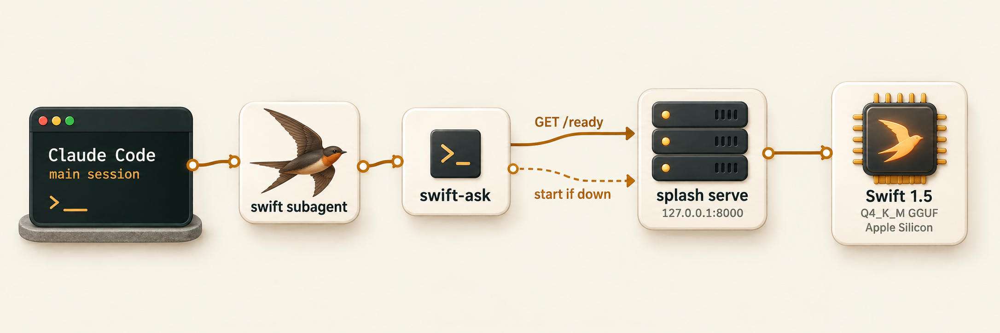

# Swift Agent

A Claude Code subagent that runs ukisai models locally on Apple Silicon. The `swift` agent uses [splash](https://github.com/incoai/splash), with [Swift 1.5](https://huggingface.co/ukisai/Swift-1.5-Qwen3.8-27B-GGUF) as its default model. It can also select other compatible ukisai models, including [Swift Bonsai 2](https://huggingface.co/ukisai/Swift-Bonsai-2-GGUF). The server starts itself on the first request.

## Quick start

Requires Python 3 and splash. [splash requires an M3 or newer Mac with macOS 26.4 or later](https://github.com/incoai/splash#quick-start). The default Swift model downloads about 17.4 GB on its first request; Swift Bonsai 2 downloads about 7.2 GB.

```bash
brew install python incoai/tap/splash
git clone https://github.com/michael-denyer/swift-agent.git
./swift-agent/install.sh
```

Make sure `~/.local/bin` is on your `PATH`, then try:

```bash
swift-ask --no-think "What is 17 * 23? Reply with the number only."
```

In Claude Code, ask for the `swift` agent by name, or say "use the local model". The installer links `swift-ask` into `~/.local/bin/` and `agents/swift.md` into `~/.claude/agents/`. Swift's first request downloads the selected model from Hugging Face; later requests use the cached weights.

## How it works



The graphic shows the default Swift 1.5 setup. `SWIFT_MODEL` changes the model served by splash.

The subagent relays the task to `swift-ask` and returns the local model's answer. The model sees only the prompt it receives, so the subagent includes the context it needs.

`swift-ask` decides what to do from `GET /ready` and its pidfile:

| Ready | Pidfile process | Action |
|---|---|---|
| ok | any | Use the running server. |
| down | alive | Wait. Another caller is starting it. |
| down | dead or missing | Remove the stale pidfile, start the server, wait. |

An exclusive lock on the start path means concurrent callers produce one server. The launcher starts `splash serve --model "$SWIFT_MODEL" --port "$SWIFT_PORT" --language-only --no-webui` detached, using the defaults below when the variables are unset. Its pidfile identity check requires a `splash serve` command line that names the model. If the server dies while starting, `swift-ask` exits nonzero and prints the tail of the server log.

## Usage

```text
swift-ask [--no-think] [--effort {max,xhigh,high,medium,low,minimal}] [--max-tokens N] [--system TEXT] [PROMPT]
swift-ask --status
swift-ask --stop
```

The prompt comes from stdin when no positional argument is given. Only the answer goes to stdout; timing and errors go to stderr. The model's thinking is dropped from the output. The default effort is `medium`, and the default token budget is 4096, including thinking.

| Variable | Default | Purpose |
|---|---|---|
| `SWIFT_HOME` | `~/.local/share/swift` | Logs, pidfile, start lock. |
| `SWIFT_MODEL` | `ukisai/Swift-1.5-Qwen3.8-27B-GGUF:Q4_K_M` | The model splash serves, as `splash serve --model` takes it. |
| `SWIFT_PORT` | `8000` | Server port on `127.0.0.1`, splash's default. |

The launcher checks `GET /ready`, reads the model id from `GET /v1/models`, and sends requests to `POST /v1/chat/completions` without streaming.

## Choose a model

| Model | Agent and launcher | Selection |
|---|---|---|
| Swift 1.5 | `swift` / `swift-ask` | Default: `ukisai/Swift-1.5-Qwen3.8-27B-GGUF:Q4_K_M`. |
| Swift Bonsai 2 | `swift` / `swift-ask` | Set `SWIFT_MODEL=ukisai/Swift-Bonsai-2-GGUF:PQ2_0`. |

### Swift Bonsai 2

[Swift Bonsai 2](https://huggingface.co/ukisai/Swift-Bonsai-2-GGUF) is ukisai's ternary Swift model. Its `PQ2_0` GGUF is about 7.2 GB. [splash supports this ternary format](https://github.com/incoai/splash#quick-start); its supported formats do not include the `PTQ1_0` variant. The switch below was tested through inference on splash 1.3.1 on an M5 Pro on 2026-10-13.

From the shell with your current model configuration, stop its server **before** changing `SWIFT_MODEL`:

```bash
swift-ask --stop
export SWIFT_MODEL='ukisai/Swift-Bonsai-2-GGUF:PQ2_0'
swift-ask --no-think "What is 17 * 23? Reply with the number only."
```

To use that model from Claude Code, start a new Claude Code session from the same shell after exporting the variable, then ask for the `swift` agent. An already running Claude Code session will not inherit a later shell export.

`SWIFT_MODEL` selects what splash starts. It does not replace a server already answering on `SWIFT_PORT`: the launcher reuses that server and its reported model id. To return to the default, run `swift-ask --stop` while the override is still set, then `unset SWIFT_MODEL` before the next request.

```bash
swift-ask --stop
unset SWIFT_MODEL
swift-ask --no-think "What is 17 * 23? Reply with the number only."
swift-ask --status
```

Both directions were verified: the arithmetic request returned `391`, and `--status` identified the selected model each time. Both models also returned `46` for `12 + 34` with `--effort medium`, exercising reasoning as well as `--no-think`.

### Other ukisai models

Set `SWIFT_MODEL` to the Hugging Face `ukisai/REPO:VARIANT` accepted by `splash serve --model`. Choose a model architecture and quantization from [splash's supported formats](https://github.com/incoai/splash/blob/main/DEVELOPMENT.md#gguf-targets); a ukisai model name alone does not establish compatibility. For example, the [Swift 1.5 GGUF repository](https://huggingface.co/ukisai/Swift-1.5-Qwen3.8-27B-GGUF/tree/main) also provides `Q5_K_M`:

```bash
swift-ask --stop
export SWIFT_MODEL='ukisai/Swift-1.5-Qwen3.8-27B-GGUF:Q5_K_M'
swift-ask --effort medium "Explain this code: ..."
```

That variant needs more disk and memory than the default. Use a distinct `SWIFT_HOME` **and** `SWIFT_PORT` for each server if you keep several models running, and pass the same settings to its requests, `--status`, and `--stop` commands.

## Model and performance

The default Swift 1.5 model uses ukisai's GGUF release because splash 1.3.1 stopped loading Splash packages ([incoai/splash#335](https://github.com/incoai/splash/pull/335)). The MLX release `ukisai/Swift-1.5-4bit-MLX` returned mixed-script output on splash 1.3.1, with or without `--disable-ane`, measured on an M5 Pro on 2026-10-13. This repository uses the GGUF release. Its weights are under the swift-open-license-1.0 carried by the model repository.

The first start downloads the 17.4 GB GGUF into the Hugging Face Hub cache, so the ready wait is 30 minutes. Cached startup time varies with loading and Neural Engine calibration. An earlier cold Swift 1.5 call with cached weights answered in 23 seconds on an M5 Pro on 2026-10-13. splash releases the weights after 10 idle minutes and reloads them on the next request.

### Inference and switching validation

Measured on 2026-10-13 with splash 1.3.1 on an M5 Pro with 20 GPU cores. Each model was warmed with arithmetic checks, then ran three prose requests with thinking disabled, 46 input tokens, no cached prompt tokens, and output capped at 256 tokens. Values are medians; downloads and startup are excluded.

| Model | End-to-end output tok/s | Generated-token rate, tok/s | Time to first token |
|---|---:|---:|---:|
| Swift 1.5 Q4_K_M | 13.6 | 14.1 | 682 ms |
| Swift Bonsai 2 PQ2_0 | 28.1 | 29.5 | 279 ms |

End-to-end rate is completion tokens divided by request wall time. Generated-token rate and time to first token come from splash's response `timings`; the generated-token rate excludes the first emitted block. Each request used this prompt, changing the run number from 1 to 3:

```bash
swift-ask --no-think --max-tokens 256 \
  "Run 1. Explain how photosynthesis works to a curious adult. Write at least 400 words of clear connected prose, with no headings or bullet points."
```

The token cap intentionally truncates the prose for comparable output lengths. These measurements describe this short-prompt workload, not model quality or long-context performance. An earlier 98-token Swift 1.5 answer reached about 58 tok/s on a different prompt; that one-off result is not a directly comparable baseline.

The Swift 1.5 launcher configuration was preserved: `Q4_K_M`, `--language-only --no-webui`, and the existing splash Neural Engine calibration (FFN share 0.38 for chunks of at least 520 rows). The launcher's defaults remain `medium` effort and 4096 tokens; the benchmark overrides apply only to its requests. Swift Bonsai 2 used the GPU FFN path because splash's Neural Engine split requires unrotated quantized projections. The test ended with the default Swift 1.5 model running again.

## Structure

- `agents/swift.md` is the Claude Code subagent definition.
- `swift-ask` is the client and launcher. Python standard library only.
- `install.sh` links the Swift launcher and agent definition into place.
- `assets/swift-architecture.png` illustrates the request and startup flow.

## Limits

Text only. The local model has no tools, file access, or memory of earlier calls. Include file contents, constraints, and the expected output format in each task. Allow extra time for the first download and cold starts.
